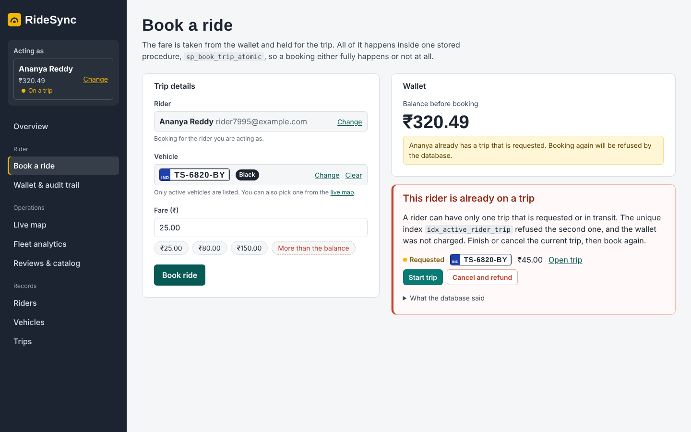

# RideSync Console: Assignment 1B front end

A web front end for the inherited **P2 RideSync** database (PostgreSQL + MongoDB). Through a browser, a rider can book a trip, see their wallet history and top up. An operations user can watch nearby vehicles on a live map, compare vehicle revenue, refresh the earnings snapshot and read rider reviews. All four Assignment 1 workflows run in the database (stored procedures, triggers, views, window functions, `$geoNear`, `$facet`); the API in between is deliberately thin.

| | |
|---|---|
| **Team** | `<team number>` (see contribution table below) |
| **GitHub repository** | `<https://github.com/<team-account>/<repo>>` (fork of `Neelesh-Srivastava435/2026201031_a1`, Assignment 1 history kept) |
| **Final commit hash** | `<fill in after the last push: git rev-parse HEAD>` |
| **Demo video (≤ 5 min)** | `<link>` (script: [docs/demo_script.md](docs/demo_script.md)) |


---

## Contents
1. [Run it](#1-run-it)
2. [Screens and how they map to the workflows](#2-screens-and-how-they-map-to-the-workflows)
3. [Tests](#3-tests)
4. [Technology choices](#4-technology-choices)
5. [Architecture](#5-architecture)
6. [Assumptions](#6-assumptions)
7. [Changes to the inherited database](#7-changes-to-the-inherited-database)
8. [Repository layout](#8-repository-layout)
9. [Contribution table](#9-contribution-table)
10. [Known limitations](#10-known-limitations)

---

## 1. Run it

### Option A: Docker (one command)

```bash
docker compose up --build
```

- Web app: **http://localhost:8080** · API health: http://localhost:4000/api/health
- The first start builds the schema, seeds about 650k rows/documents and back-fills the wallet ledger. This takes a few minutes; watch `docker compose logs -f seed`.
- Data persists in Docker volumes. To start again from scratch: `docker compose run --rm -e RESEED=1 seed`.
- Only Docker Desktop is needed. The containers' databases use host ports **5433** (PostgreSQL) and **27018** (MongoDB), so they don't clash with a PostgreSQL or MongoDB already installed on the PC.
- Stop everything with `docker compose down`. Start it again later with `docker compose up` (no re-seeding; the data stays in the volumes). `docker compose down -v` also deletes the data.

### Option B: run locally (Windows PowerShell shown; macOS/Linux commands are the same apart from venv activation)

**Prerequisites:** PostgreSQL 16, MongoDB 7 with `mongosh`, Python 3.10+, Node.js 20+ (`psql`, `mongosh`, `python`, `node` on PATH).

```powershell
# 0. configuration (shared by seeders and API)
copy .env.example .env          # then set POSTGRES_PASSWORD
createdb -U postgres ridesync_db

# 1. Python deps for the seeders
python -m venv venv; .\venv\Scripts\Activate.ps1
pip install -r data_generation\requirements.txt

# 2. schema, Mongo indexes, seed data, ledger back-fill, DB tests (one script)
powershell -ExecutionPolicy Bypass -File scripts\setup_db.ps1
#   macOS/Linux:  mongosh ridesync_db mongo/01_collections_and_indexes.js && bash scripts/setup_db.sh

# 3. API (terminal 1)
cd api; npm install; npm start          # http://localhost:4000/api/health

# 4. Web (terminal 2)
cd web; npm install; npm run dev        # http://localhost:5173
```

If you'd rather run the steps by hand, `scripts/setup_db.sh` lists them in order: `sql/01`–`05`, `07` → `postgres_seeder.py` → `mongo_seeder.py` → `sql/08` → `REFRESH MATERIALIZED VIEW`.

**First thing to do in the app:** choose a rider in **"Acting as"** (top of the sidebar). There's no login; the choice is remembered in the browser.

---

## 2. Screens and how they map to the workflows

| Screen | What you can do | Database objects it drives |
|---|---|---|
| **Book a trip** (Workflow 1) | Pick vehicle + fare → book. See **balance before → after** and the **new `wallet_audit_logs` row** (marked as written by the trigger). Failures get specific, actionable panels: *insufficient balance* (shows the shortfall + top-up buttons) and *already on a trip* (names `idx_active_rider_trip`, shows the blocking trip with Complete/Cancel buttons). "What the database said" reveals the raw SQLSTATE. | `sp_book_trip_atomic`, `trg_audit_wallet_balance`, `idx_active_rider_trip`, `sp_topup_wallet` |
| **Trip detail / status buttons** | Move a trip **Requested → In transit → Completed**, or **Cancel and refund**. This frees the rider for a new booking, so the partial unique index can be demonstrated repeatedly. | `sp_update_trip_status` |
| **Wallet & audit trail** | Read-only ledger for any rider with a **date filter** (presets + custom range), a **running balance** column with ✓ consistency check, a balance-over-time chart, totals in/out, and pagination. | `wallet_audit_logs`, `fn_rider_audit_trail` (window function) |
| **Fleet analytics** (Workflow 2 + MV) | **7-day moving average** line chart for up to 3 vehicles; **DENSE_RANK() table** for any day, filterable by class; **materialized-view summary** with "last refreshed …", a "trips completed since refresh" warning and a **Refresh snapshot** button. | `vw_vehicle_moving_avg`, `vw_vehicle_revenue_ranking` (the Part A query), `mv_vehicle_lifetime_earnings`, `fn_refresh_vehicle_earnings_mv()` |
| **Live map** (Workflow 3) | Choose a locality or click the map to set the origin. A **5 km circle** and the nearest available vehicles appear, with a list sorted by distance. Polls every 5 s; vehicles new since the last poll are flagged. "Book" opens the booking form with that car. | `$geoNear` on `TelemetryPings` (2dsphere, TTL) |
| **Reviews & catalog** (Workflow 4) | Rating distribution, top feedback tags and overall average/std-dev from **one `$facet`**, filterable by vehicle/dates. Latest reviews list. **VehicleMetadata** shown as a readable card (features, inspection timeline, raw JSON toggle). | `$facet` on `TripReviews`, `VehicleMetadata` |
| **Riders / Vehicles / Trips** | Server-side pagination (25 rows), search, filters and sort kept in the URL; detail page per record. | indexed SQL; nothing loads all rows into the browser |

Every data view handles **loading** (skeleton rows), **empty** (what to do next) and **error** (message, error code, retry) states. A banner says which database is down if either is unreachable. The layout works down to phone width; at 390 px no page scrolls sideways (checked on every route).

| | |
|---|---|
|  |  |
|  |  |
|  |  |

Phone: [booking](docs/screenshots/09_mobile_book.png) · [audit](docs/screenshots/10_mobile_audit.png).
**TODO before submission:** add screenshots of the Live map and Reviews pages taken on your own machine, with real MongoDB and map tiles.

---

## 3. Tests

We tested the parts where a mistake would cost money or hide a failure: the booking transaction, its failure paths, the trip life-cycle and the ledger.

| Suite | Command | What it proves |
|---|---|---|
| **Database** (9 tests) | `psql -U postgres -d ridesync_db -f sql/tests/test_workflows.sql` | Booking debits and the trigger logs `TRIP_ESCROW_DEBIT`; `updated_at` is maintained; second active trip → 23505 and the balance is untouched; invalid status jumps → RS005; cancel refunds and is logged; insufficient → RS001 with no audit row; zero/negative fare, inactive vehicle and bad top-up are rejected; the running balance matches `balance_after`; rank 1 = best moving average. Runs in a transaction that is **rolled back**. |
| **API unit** (14 tests, no DB needed) | `cd api && npm test` | One transaction per booking (BEGIN…COMMIT/ROLLBACK); each SQLSTATE maps to the right HTTP status and code with UI context (shortfall, blocking trip); bad input is rejected **before any SQL**; page size is capped; search text is a bound parameter; the `$geoNear`/`$facet` pipelines keep the Part A stages; MongoDB down → 503, and the trip page still works. |
| **API integration** (6 steps) | `cd api && npm run test:integration` | The same flows against the **real** procedures and trigger: book → blocked second booking → status path → insufficient → top-up → cancel/refund → audit trail consistent. Creates and deletes its own rider. |
| **End-to-end** (5 tests, Playwright) | `cd web && npx playwright install chromium && npm run test:e2e` (API + web running) | In a real browser: success shows before/after + the trigger's audit row; second booking blocked, then unblocked from the error panel; insufficient balance → top-up → success; client-side fare validation; audit page consistency message. |

---

## 4. Technology choices

| Layer | Choice | Why |
|---|---|---|
| Front end | **React 19 + TypeScript + Vite** | The team knows React. TypeScript types (`web/src/types.ts`) mirror the API responses, which catches shape mistakes early. Vite gives instant dev reloads and a `/api` proxy, so there's no CORS setup. |
| Routing | small hash router (`web/src/lib/router.tsx`, ~60 lines) | Seven screens don't need a routing library. Hash URLs work on any static host, and filters/pages are kept in the URL so links can be shared. |
| Charts | **hand-written SVG** (`components/charts.tsx`) | We need three simple chart types. Writing them ourselves kept the bundle small, gave us full control of colours and accessibility labels, and let us explain every line in the viva. |
| Map | **Leaflet + OpenStreetMap** tiles | Free, no API key, lightweight. Used directly (not through a React wrapper) because we only need a circle and markers. |
| Styling | plain CSS with design tokens (`styles/tokens.css`) | One small stylesheet keeps every screen consistent (see `docs/design/style_guide.md`), and we avoid a utility-class framework the whole team would have to learn. |
| API | **Node.js `http` + a 40-line router**, `pg`, `mongodb` | The brief asks for a thin layer. Two runtime dependencies, one language across API and UI, and every endpoint is a few lines that call a procedure, view or pipeline. Dependencies are passed in (`createApp({pg, mongo})`), so unit tests run without databases. |
| Tests | `node:test` (built in), `psql` script, Playwright | No extra test framework for the API. Playwright tests the workflow the way a user does. |
| Delivery | Docker Compose + `scripts/setup_db.*` | One command for reviewers, plus a step-by-step path for people who already have PostgreSQL/MongoDB installed. |

---

## 5. Architecture

```
Browser (React)  ──/api/*──▶  API (Node, thin)  ──▶  PostgreSQL 16
  hash routes                  validate input         sp_book_trip_atomic, sp_update_trip_status, sp_topup_wallet
  useApi() hook                call procedure/view    trg_audit_wallet_balance (+ updated_at trigger)
  polling (map 5 s)            map SQLSTATE → JSON    fn_rider_audit_trail, vw_vehicle_moving_avg,
                                                      vw_vehicle_revenue_ranking, mv_vehicle_lifetime_earnings
                               ──▶  MongoDB 7
                                    $geoNear (TelemetryPings), $facet (TripReviews), VehicleMetadata
                               telemetry simulator: inserts live pings every 5 s (TTL would empty the map)
```

Business rules stay in the database: the API never computes balances, never decides whether a status change is allowed, and never runs analytics in JavaScript. Allowed status buttons are shown from a mirror of the procedure's table, but `sp_update_trip_status` makes the final decision, and its refusal is displayed.

---

## 6. Assumptions

1. **Indian context.** Currency is ₹ (INR); riders have Indian names and vehicles Indian (mostly Telangana) plates.

2. **No authentication.** "Acting as" switches the rider for demos, as the brief allows.
3. **Escrow semantics.** Booking debits the fare (held in escrow). Completing keeps it (there are no driver payouts in this schema). Cancelling, from REQUESTED or IN_TRANSIT, refunds it in full.
4. **Trip life-cycle:** REQUESTED → IN_TRANSIT → COMPLETED, and REQUESTED/IN_TRANSIT → CANCELLED. COMPLETED and CANCELLED are final.
5. **Seeded ledger.** Seeded CANCELLED trips are treated as cancelled before payment, so they have no wallet movement. The back-filled history uses top-ups plus one debit per non-cancelled trip and ends exactly at each rider's seeded balance.
6. **Moving average** follows Assignment 1: the average of the vehicle's last 7 *active* days, not 7 calendar days. Ranks on the ranking table are platform-wide even when filtered by class, so filtered ranks can have gaps.
7. **"Nearest vehicle"** = the latest available ping per vehicle inside 5 km within the selected window (default 15 min). The Part A `$geoNear` stage is unchanged; we add de-duplication by vehicle because pings now carry real vehicle ids.
8. **Top-ups** are capped at ₹5,000 per transaction (a demo guard in `sp_topup_wallet`).
9. Running the E2E/integration tests changes data (bookings, refunds, top-ups) for one rider. The SQL test suite rolls back.

---

## 7. Changes to the inherited database

The handover note explains each change: [docs/handover_note.md](docs/handover_note.md). Every edit is marked `[A1B]` in the file.

| File | Change |
|---|---|
| `sql/01_schema_ddl.sql` | `wallet_audit_logs.reference_trip_id` (nullable) |
| `sql/02_indexes.sql` | `idx_trips_rider_created`, `idx_wallet_audit_reference_trip` |
| `sql/03_triggers_and_audit.sql` | fixed `updated_at` (BEFORE trigger); reason-aware action types; `clock_timestamp()` |
| `sql/04_stored_procedures.sql` | fare > 0 guard; distinct SQLSTATEs RS001–RS004; audit row linked to trip |
| `sql/07_frontend_support.sql` | **new**: `sp_update_trip_status`, `sp_topup_wallet`, `fn_rider_audit_trail`, analytics views |
| `sql/08_seed_audit_history.sql` | **new**: consistent ledger back-fill for seeded riders |
| `sql/09_localize_india.sql` | **new**: Indian rider names/emails and Indian plates for already-seeded data (deterministic) |
| `data_generation/sync_vehicle_plates.py` | **new**: copies the plates into MongoDB `VehicleMetadata` after `09` |
| `data_generation/postgres_seeder.py` | `Faker('en_IN')` names and Indian plate format for fresh seeds |
| `sql/tests/test_workflows.sql` | **new**: database tests |
| `data_generation/mongo_seeder.py` | real PostgreSQL ids; vehicle tracks; idempotent; no future-dated reviews |
| `mongo/*.js` | `const db = db.getSiblingDB(...)` → `db = ...` |

The original Assignment 1 README is kept at [docs/assignment1_README.md](docs/assignment1_README.md).

---

## 8. Repository layout

```
├── README.md                    this file
├── docker-compose.yml           postgres, mongo, mongo-init, seed, api, web
├── .env.example                 shared settings (seeders + API)
├── docs/
│   ├── handover_note.md         what worked / what we changed / suggestions
│   ├── api_endpoints.md         endpoint list with inputs and outputs
│   ├── demo_script.md           5-minute demo walkthrough
│   ├── design/                  users.md, style_guide.md, wireframes/
│   ├── screenshots/
│   └── assignment1_README.md    original README (unchanged)
├── sql/  mongo/  data_generation/  performance/     Assignment 1 (+ fixes, 07, 08, tests/)
├── scripts/                     setup_db.sh, setup_db.ps1
├── api/                         Node API: src/routes/*, src/services/telemetrySimulator.js, test/, integration/
└── web/                         React app: src/pages/*, src/components/*, src/lib/*, e2e/
```

---

## 9. Contribution table

| Member | Roll no. | Design | Code | Docs / tests |
|---|---|---|---|---|
| `<name>` | `<roll>` | | | |
| `<name>` | `<roll>` | | | |
| `<name>` | `<roll>` | | | |
| `<name>` | `<roll>` | | | |

---

## 10. Known limitations

- No real authentication or authorisation. Anyone can act as any rider.
- The materialized view only changes when refreshed. This is intentional, and the UI shows how stale it is.
- The live-ping simulator is demo scaffolding. In production, pings would come from driver apps.
- The ranking query computes all vehicles' moving averages for the chosen day (~0.3 s on 100k trips). A larger dataset would need a materialized daily table.
- The Live map needs internet access for OpenStreetMap tiles. Without it, markers still show on a blank background.
